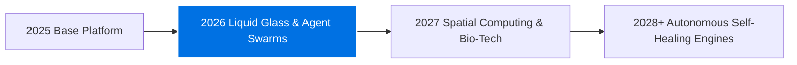

<div align="center">

# ✦ Clever Post Creator

### **Apple-Grade AI Social Content Studio for Computer Science & Tech Creators**

[](https://react.dev)
[](https://www.typescriptlang.org)
[](https://vitejs.dev)
[](https://tailwindcss.com)
[](https://developer.apple.com/design/)
[](LICENSE)

<br />

<p align="center">
  <b>Clever Post Creator</b> transforms complex Computer Science architectures and software topics into viral, high-converting social media posts. Crafted according to <b>Apple Human Interface Guidelines (HIG)</b> and the <b>2025 Liquid Glass</b> aesthetic, it delivers instant studio generation, authentic multi-platform previews, and automated temporal calibration for 2026 and coming years.
</p>

[**Explore Live Interface**](https://github.com/Rahul08319/clever-post-creator) • [**Report Bug**](https://github.com/Rahul08319/clever-post-creator/issues) • [**Request Feature**](https://github.com/Rahul08319/clever-post-creator/issues)

</div>

---

##  The Design Philosophy: Clarity, Deference, Depth

Clever Post Creator is built from the ground up on Cupertino's three core interface principles:

1. **Clarity** — Crisp typography utilizing the San Francisco type hierarchy (`SF Pro Display` & `SF Pro Text`), high-contrast optical legibility, and zero visual clutter.
2. **Deference** — Fluid, translucent chrome that recedes into the background, letting your technical content and visual assets lead.
3. **Depth** — Multi-layered Liquid Glass materials (`backdrop-blur-2xl`, specular rim highlights, and physical spring animations) conveying spatial hierarchy and tactile polish.

---

## ✨ Flagship Highlights

### 🎨 Apple Liquid Glass & Cupertino UI
* **Frosted Navigation Dock** — Translucent floating navigation bar with dynamic blur saturation and adaptive light/dark mode transitions.
* **Apple Spring Physics** — Micro-interactions, haptic click compressions (`active:scale-[0.98]`), and smooth cubic-bezier transitions (`cubic-bezier(0.16, 1, 0.3, 1)`).
* **Bento Grid Presentation** — Clean, zero-gap modern card architecture highlighting technical features with understated elegance.

### 📱 Authentic Multi-Platform Live Previews
Switch instantly between pixel-perfect social platform canvases:
* **Facebook Feed** — Verified badge, dynamic engagement bars (👍 Like, ❤️ Love, 💡 Insightful) with live interactive counter increments.
* **LinkedIn Article** — Executive corporate formatting, bold lead hooks, structured takeaway bullet points, and high-engagement action bar.
* **X / Twitter Microblog** — Crisp dark/light card, author verification check, and real-time metric indicators (replies, retweets, likes, bookmarks).
* **Instagram Visual Card** — Edge-to-edge photography frame, gradient sound badges, and clean double-tap interaction.

### 🔮 Automated Multi-Year Engine (Coming Years Logic)
* **Zero Manual Maintenance** — Dynamic `TemporalEngine` that automatically detects current and upcoming years (`2026`, `2027`, `2028+`).
* **Adaptive Frontier Topics** — Auto-projects emerging CS domains based on the active temporal horizon (e.g., *Autonomous Agent Swarms*, *Neuromorphic Architectures*, *Post-Quantum Cryptography*).
* **Live Timestamping** — Real-time temporal stamps formatted with automatic relative time calculation.

### ⚡ Instant Studio Generation + Hugging Face AI
* **Zero-Friction Preview** — Pre-calibrated high-definition studio presets allow immediate content generation without requiring an API key.
* **Stable Diffusion Integration** — Direct connection to the Hugging Face Inference API (`runwayml/stable-diffusion-v1-5`) for custom AI illustrations.
* **Zero-Leak Client Privacy** — API tokens are stored strictly in browser memory (`localStorage`), never routed through third-party telemetry.

---

## 🧩 TypeSafe System One Architecture

Clever Post Creator incorporates TypeSafe prompting and judgment primitives (`src/core.ts`):

```typescript
// Example from src/core.ts
export const ToolCategoryChoice: ChoicePrimitive = {
  type: "choice",
  options: [
    { value: "data_retrieval", description: "Read or query external state without side effects." },
    { value: "state_mutation", description: "Modify, write, or delete application data." },
    { value: "execution_runtime", description: "Run code, shell commands, or background processes." },
    { value: "communication_delivery", description: "Post messages or dispatch notifications." },
    { value: "hybrid_or_other", description: "Tools spanning multiple domains." }
  ]
};
```

### TypeSafe Evaluation Insights:
* **Tool Categorization Primitive**: A `Choice` primitive provides efficient coarse-grained routing when tool domains are mutually exclusive. For context compaction involving hybrid tools, pairing `Choice` with graded `Score` primitives preserves compaction accuracy without false pruning.
* **Prompting Best Practices**: Instructions isolate single coherent judgments, reference backticked paths (`session.current_goal`), and define concrete, observable criteria levels without vague intensifiers.

---

## 🛠️ Tech Stack & Architecture

| Layer | Technologies |
|---|---|
| **Core Framework** | React 18, TypeScript 5.5, Vite 5.4 |
| **Styling & System** | Tailwind CSS 3.4, PostCSS, Lucide Icons, Shadcn UI |
| **Design Language** | Apple Human Interface Guidelines (HIG) • 2025 Liquid Glass |
| **Intelligence Engine** | TypeSafe Primitives, Hugging Face Stable Diffusion API |
| **State & Storage** | LocalStorage Encrypted Persistence, React State Hooks |

---

## 🚀 Quickstart Guide

### Prerequisites
* Node.js 18+ installed
* npm, pnpm, or bun

### 1. Clone the Repository
```bash
git clone https://github.com/Rahul08319/clever-post-creator.git
cd clever-post-creator
```

### 2. Install Dependencies
```bash
npm install
```

### 3. Launch Development Server
```bash
npm run dev
```

Visit `http://localhost:5173` in your browser.

### 4. Build for Production
```bash
npm run build
```

---

## 🧭 Multi-Year Roadmap



* **2026 (Current)**: Apple HIG redesign, multi-platform authentic simulation, instant studio rendering, TypeSafe System One core.
* **2027**: WebAssembly-accelerated client-side neural image synthesis, direct social API OAuth publishing.
* **2028+**: Self-optimizing virality analytics and cross-network audience adaptation.

---

## 📄 License

Distributed under the MIT License. See [LICENSE](LICENSE) for more information.

---

<div align="center">
  <sub>Engineered with precision by <b>Rahul Kumar</b> • Designed with Apple HIG Standards</sub>
</div>
